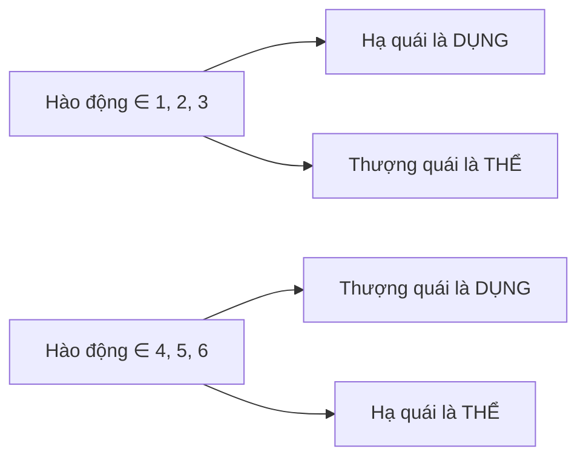
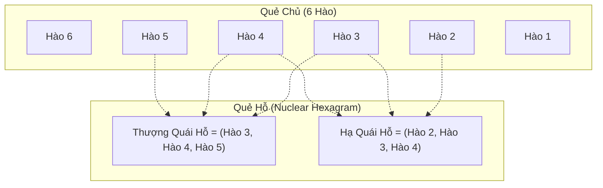
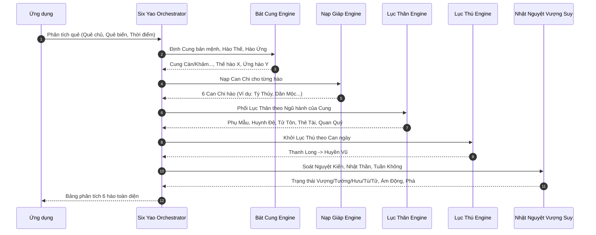

# CÁC THUẬT TOÁN LẬP QUẺ & PHÂN TÍCH
## Dự án: Kinh Dịch - Bắc Hà Tân An Phái
**Phiên bản tài liệu:** 1.0.0  
**Ngày cập nhật:** 31/10/2026  
**Đặc tính:** Hàm thuần túy toán học (Deterministic Pure Functions), không side-effects, 100% Offline

---

## 1. TỔNG HỢP CÁC THUẬT TOÁN HỆ THỐNG

| Mã thuật toán | Tên gọi nghiệp vụ | Phạm vi ứng dụng | Trạng thái xác minh |
| :--- | :--- | :--- | :--- |
| `SERIAL-MOD8-V1` | Lập quẻ theo số Seri tiền | Bốc Phệ Chính Tông hiện đại | **Đã xác minh toán học & cổ pháp** |
| `MAI-HUA-V1` | Lập quẻ theo Giờ Động Tâm | Mai Hoa Dịch Số (Thiệu Khang Tiết) | **Đã xác minh theo nguyên bản Tống triều** |
| `TRIO-GEN-V1` | Sinh Quẻ Biến & Quẻ Hỗ | Đồ bản Kinh Dịch cổ điển | **Đã xác minh chuẩn 64 quẻ** |
| `VN-LUNAR-V1` | Thiên văn Nông lịch Việt Nam | Can Chi 4 trụ, Tiết Khí, Tuần Không | **Đã xác minh chuẩn UTC+7 (105°E)** |
| `SIX-YAO-V1` | Điều phối Phân tích Lục Hào | Bát Cung, Nạp Giáp, Lục Thân, Lục Thú | **Đã xác minh theo Bốc Phệ Chính Tông** |
| `STRENGTH-V1` | Đánh giá Ngũ hành Vượng suy | Nhật Thần, Nguyệt Kiến, Ám Động, Phá | **Đã xác minh theo Tăng San Bốc Dịch** |
| `CHU-HI-V1` | Luận giải Kinh văn theo Hào động | Chu Dịch Bản Nghĩa (Chu Hi) | **Đã xác minh quy tắc cổ điển** |

---

## 2. THUẬT TOÁN LẬP QUẺ BẰNG SERI TIỀN (`SERIAL-MOD8-V1`)

### 2.1. Căn cứ triết học & toán học
Phương pháp bốc quẻ bằng số seri tiền polymer là sự kết hợp chuẩn tắc giữa số học phương Đông và vật phẩm mang năng lượng giao thương hiện đại:
- **Vị trí lẻ (1, 3, 5, 7...):** Thuộc Dương tính, đại diện cho Trời (Thiên), dùng để tính **Thượng quái (Quẻ trên)**.
- **Vị trí chẵn (2, 4, 6, 8...):** Thuộc Âm tính, đại diện cho Đất (Địa), dùng để tính **Hạ quái (Quẻ dưới)**.
- **Tổng toàn bộ chuỗi số:** Đại diện cho Vạn vật (Nhân), dùng để xác định **Hào động**.

### 2.2. Chi tiết công thức tính
Cho chuỗi số seri gồm $n$ chữ số $S = (d_1, d_2, d_3, \dots, d_n)$:

$$\text{Tổng lẻ } S_{\text{lẻ}} = \sum_{i=1, 3, 5, \dots} d_i$$

$$\text{Tổng chẵn } S_{\text{chẵn}} = \sum_{i=2, 4, 6, \dots} d_i$$

$$\text{Tổng toàn bộ } S_{\text{tổng}} = \sum_{i=1}^{n} d_i$$

1. **Thượng quái:** $Q_{\text{thượng}} = S_{\text{lẻ}} \pmod 8$. Nếu dư $0$, lấy số $8$ (Quẻ Khôn).
2. **Hạ quái:** $Q_{\text{hạ}} = S_{\text{chẵn}} \pmod 8$. Nếu dư $0$, lấy số $8$ (Quẻ Khôn).
3. **Hào động:** $L_{\text{động}} = S_{\text{tổng}} \pmod 6$. Nếu dư $0$, lấy hào $6$ động.

**Bảng ánh xạ số dư sang Bát Quái Tiên Thiên:**
`1: Càn (☰)`, `2: Đoài (☱)`, `3: Ly (☲)`, `4: Chấn (☳)`, `5: Tốn (☴)`, `6: Khảm (☵)`, `7: Cấn (☶)`, `8: Khôn (☷)`.

---

## 3. THUẬT TOÁN LẬP QUẺ MAI HOA DỊCH SỐ (`MAI-HUA-V1`)

### 3.1. Căn cứ cổ bản Thiệu Khang Tiết
Phương pháp lập quẻ theo thời gian động tâm dựa trên bốn yếu tố thời gian thiên văn: Năm, Tháng, Ngày và Giờ âm lịch.

### 3.2. Chi tiết công thức tính
Gọi:
- $Y$: Số thứ tự Địa chi của Năm ($1: \text{Tý}, 2: \text{Sửu}, \dots, 12: \text{Hợi}$).
- $M$: Tháng âm lịch ($1 \dots 12$).
- $D$: Ngày âm lịch ($1 \dots 30$).
- $H$: Số thứ tự Địa chi của Giờ ($1: \text{Tý}, 2: \text{Sửu}, \dots, 12: \text{Hợi}$).

$$\text{Thượng quái } Q_{\text{thượng}} = (Y + M + D) \pmod 8 \quad (\text{dư } 0 \to 8)$$

$$\text{Hạ quái } Q_{\text{hạ}} = (Y + M + D + H) \pmod 8 \quad (\text{dư } 0 \to 8)$$

$$\text{Hào động } L_{\text{động}} = (Y + M + D + H) \pmod 6 \quad (\text{dư } 0 \to 6)$$

### 3.3. Xác định Thể Quái & Dụng Quái
- **Thể Quái (Chủ thể):** Là đơn quái (thượng quái hoặc hạ quái) **không chứa** hào động. Đại diện cho bản thân người hỏi sự việc, bất biến, làm gốc.
- **Dụng Quái (Khách thể / Biến cố):** Là đơn quái **chứa** hào động. Đại diện cho sự việc bên ngoài, biến động, ứng đối.

---

## 4. THUẬT TOÁN SINH BỘ BA QUẺ (`TRIO-GEN-V1`)

Từ Quẻ Chủ (Primary Hexagram) và danh sách hào động, hệ thống suy diễn ra Quẻ Biến và Quẻ Hỗ:

### 4.1. Sinh Quẻ Biến (`calculateChangingHexagram`)
Đảo ngược tính chất âm dương tại các vị trí hào động:
- Hào Dương ($1$) động $\to$ Hóa Âm ($0$).
- Hào Âm ($0$) động $\to$ Hóa Dương ($1$).
- Các hào tĩnh giữ nguyên trạng thái.
- Nếu không có hào nào động: Quẻ biến trùng với quẻ chủ (Quẻ Tĩnh).

### 4.2. Sinh Quẻ Hỗ (`calculateNuclearHexagram`)
Quẻ Hỗ đại diện cho diễn biến ngầm ở giai đoạn giữa của sự việc, được trích xuất từ nội tại quẻ chủ:
- **Hạ quái của quẻ hỗ:** Tạo bởi các hào 2, 3, 4 của quẻ chủ.
- **Thượng quái của quẻ hỗ:** Tạo bởi các hào 3, 4, 5 của quẻ chủ.

---

## 5. THUẬT TOÁN THIÊN VĂN NÔNG LỊCH VIỆT NAM (`VN-LUNAR-V1`)

### 5.1. Quy chuẩn thiên văn
- Tọa độ tham chiếu: Kinh tuyến $105^\circ\text{E}$ (Múi giờ UTC+7).
- Tiêu chuẩn Lịch Việt Nam theo Nghị định 121/CP (1967) và Quyết định 134/2002/QĐ-TTg.

### 5.2. Tính Can Chi
1. **Can Chi Năm:**
   - Thiên Can: $(Y + 6) \pmod{10}$ $\to$ $0: \text{Giáp}, 1: \text{Ất}, \dots, 9: \text{Quý}$.
   - Địa Chi: $(Y + 8) \pmod{12}$ $\to$ $0: \text{Tý}, 1: \text{Sửu}, \dots, 11: \text{Hợi}$.
2. **Can Chi Tháng:** Tính theo bài ca Ngũ Hổ Độn dựa trên Thiên Can của Năm. Lệnh tháng tính theo Tiết Khí (ví dụ: Lập Xuân sang tháng Dần).
3. **Can Chi Ngày:** Tính thông qua số ngày Julian Day Number (JDN) từ mốc thiên văn.
4. **Can Chi Giờ:** Tính theo bài ca Ngũ Thử Độn dựa trên Thiên Can của Ngày:
   - *Giáp Kỷ hoàn gia Giáp (Giờ Tý là Giáp Tý)*
   - *Ất Canh Bính tác sơ (Giờ Tý là Bính Tý)*
   - *Bính Tân tầm Mậu khởi (Giờ Tý là Mậu Tý)*
   - *Đinh Nhâm Canh Tý cư (Giờ Tý là Canh Tý)*
   - *Mậu Quý hà phương phát, Nhâm Tý thị chân đồ (Giờ Tý là Nhâm Tý)*

### 5.3. Thuật toán Tuần Không (Không Vong)
Căn cứ vào Can Chi của Ngày bốc quẻ, xác định tuần Giáp tương ứng trong Lục Thập Hoa Giáp:
- Giáp Tý tuần: Tuất, Hợi Không.
- Giáp Tuất tuần: Thân, Dậu Không.
- Giáp Thân tuần: Ngọ, Mùi Không.
- Giáp Ngọ tuần: Thìn, Tỵ Không.
- Giáp Thìn tuần: Dần, Mão Không.
- Giáp Dần tuần: Tý, Sửu Không.

---

## 6. THUẬT TOÁN ĐIỀU PHỐI PHÂN TÍCH LỤC HÀO (`SIX-YAO-V1`)

Hệ thống phối hợp 6 bước cổ pháp tuần tự:

1. **Bát Cung:** Xác định quẻ thuộc cung nào trong 8 cung (Càn, Khảm, Cấn, Chấn, Tốn, Ly, Khôn, Đoài), tìm thứ bậc sinh biến (Bản Cung, Nhất thế, Nhị thế, Tam thế, Tứ thế, Ngũ thế, Du Hồn, Quy Hồn) để định vị hào Thế và hào Ứng.
2. **Nạp Giáp:** An Can Chi cụ thể cho từng hào từ hào 1 đến hào 6 dựa theo quy ước Kinh Phòng.
3. **Lục Thân:** So sánh Ngũ hành của Can Chi từng hào với Ngũ hành của Cung bản mệnh:
   - Cung sinh Hào $\to$ **Tử Tôn**
   - Hào sinh Cung $\to$ **Phụ Mẫu**
   - Cung khắc Hào $\to$ **Thê Tài**
   - Hào khắc Cung $\to$ **Quan Quỷ**
   - Cung đồng Hào $\to$ **Huynh Đệ**
4. **Lục Thú:** Dựa vào Thiên Can của ngày lập quẻ:
   - Ngày Giáp, Ất: Hào 1 khởi Thanh Long.
   - Ngày Bính, Đinh: Hào 1 khởi Chu Tước.
   - Ngày Mậu: Hào 1 khởi Câu Trần.
   - Ngày Kỷ: Hào 1 khởi Đằng Xà.
   - Ngày Canh, Tân: Hào 1 khởi Bạch Hổ.
   - Ngày Nhâm, Quý: Hào 1 khởi Huyền Vũ.
5. **Xét Vượng Suy:**
   - Ngũ hành cùng mùa Nguyệt Kiến $\to$ **Vượng**.
   - Ngũ hành được mùa Nguyệt Kiến sinh $\to$ **Tướng**.
   - Ngũ hành sinh mùa Nguyệt Kiến $\to$ **Hưu**.
   - Ngũ hành bị mùa Nguyệt Kiến khắc $\to$ **Tù**.
   - Ngũ hành khắc mùa Nguyệt Kiến $\to$ **Tử**.
6. **Xét Tương Tác Đặc Biệt:**
   - **Ám Động:** Hào tĩnh có khí Vượng/Tướng bị Nhật Thần tương xung.
   - **Nhật Phá:** Hào tĩnh bị suy thoái (Hưu/Tù/Tử) bị Nhật Thần tương xung.
   - **Nguyệt Phá:** Hào có Địa Chi tương xung với Chi của Nguyệt Kiến.
   - **Tuần Không (Chân Không / Giả Không):** Hào rơi vào Địa Chi Tuần Không, nếu có động hoặc được nhật nguyệt sinh phù thì là Giả Không; nếu suy tuyệt lại tĩnh thì là Chân Không.

---

## 7. THUẬT TOÁN LUẬN GIẢI CHU HI (`CHU-HI-V1`)

Áp dụng 7 nguyên tắc phân tích kinh văn dựa trên số lượng hào động theo *Chu Dịch Bản Nghĩa*:
1. **0 hào động (Quẻ Tĩnh):** Lấy Thoán từ (Quẻ từ) của Quẻ Chủ làm chính, tham khảo thêm Đại Tượng từ.
2. **1 hào động:** Lấy Hào từ của chính hào động đó ở Quẻ Chủ để luận đoán cát hung.
3. **2 hào động:** Xem Hào từ của cả 2 hào động ở Quẻ Chủ, nhưng lấy **hào ở trên** làm chủ đạo.
4. **3 hào động:** Lấy Thoán từ của Quẻ Chủ làm gốc (chính) và tham chiếu Thoán từ của Quẻ Biến làm ngọn (phụ).
5. **4 hào động:** Xem 2 hào tĩnh còn lại ở **Quẻ Biến**, lấy **hào tĩnh ở dưới** làm chủ đạo.
6. **5 hào động:** Xem duy nhất 1 hào tĩnh còn lại ở **Quẻ Biến**.
7. **6 hào động (Toàn động):**
   - Với quẻ Thuần Càn: Dùng hào từ **Dụng Cửu** ("Kiến quần long vô thủ, cát").
   - Với quẻ Thuần Khôn: Dùng hào từ **Dụng Lục** ("Lợi vĩnh trinh").
   - Với 62 quẻ còn lại: Lấy Thoán từ của **Quẻ Biến** để đoán định.
