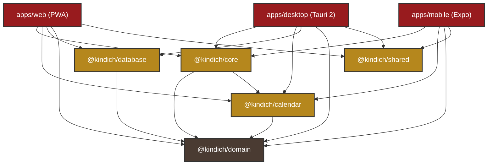
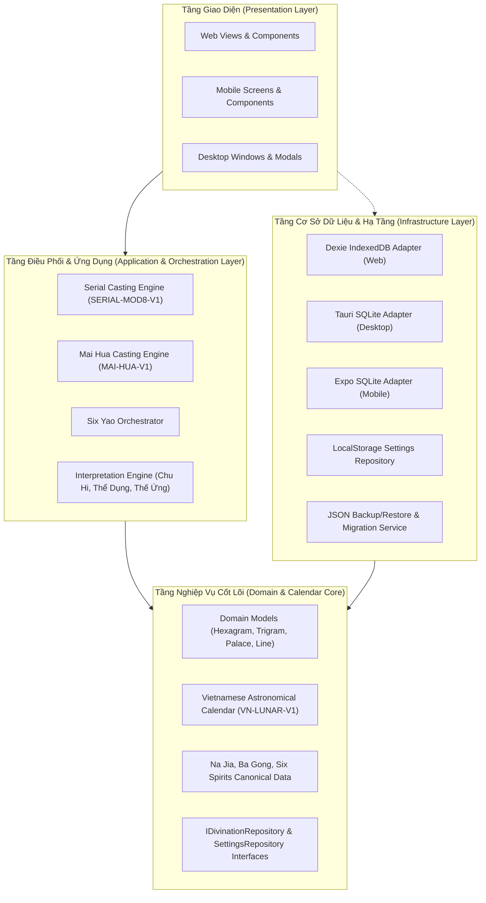

# KIẾN TRÚC TỔNG THỂ DỰ ÁN KINHDICH
## Hệ thống Chiêm bốc & Dịch học Cổ pháp - Bắc Hà Tân An Phái
**Phiên bản tài liệu:** 1.0.0  
**Ngày cập nhật:** 31/10/2026  
**Mô hình kiến trúc:** Monorepo đa nền tảng (Clean Architecture, Offline-First, Local-First)

---

## 1. TỔNG QUAN HỆ THỐNG

Dự án **KinhDich** được thiết kế để giải quyết bài toán hiện đại hóa học thuật Kinh Dịch cổ truyền phương Đông trên nền tảng kỹ thuật số với các tiêu chuẩn công nghệ cao:
- **Đa nền tảng thực thụ:** Chạy trên trình duyệt Web (PWA), điện thoại di động (Android & iOS qua React Native/Expo), và máy tính để bàn (Windows native qua Tauri 2).
- **Offline-First 100%:** Toàn bộ thuật toán lập quẻ, nạp can chi, phân tích Lục Hào, tính toán lịch pháp thiên văn và diễn giải kinh văn được thực thi trực tiếp trên thiết bị của người dùng mà không cần bất kỳ kết nối mạng nào.
- **Local-First Data Storage:** Dữ liệu lịch sử, câu hỏi, ghi chú và nghiệm lý cá nhân được lưu trữ bảo mật trong cơ sở dữ liệu cục bộ (IndexedDB trên Web, SQLite trên Mobile và Desktop).
- **Zero Business Logic Duplication:** Toàn bộ tri thức nghiệp vụ cốt lõi (Core Engine, Calendar Engine, Domain Entities, Quy tắc Lục Hào) được đóng gói trong các package độc lập và dùng chung cho toàn bộ các ứng dụng.

---

## 2. KIẾN TRÚC MONOREPO & PHÂN CHIA WORKSPACE

Hệ thống sử dụng **pnpm workspaces** kết hợp TypeScript strict mode. Toàn bộ mã nguồn được chia thành hai nhóm: `packages/` (thư viện nghiệp vụ dùng chung) và `apps/` (ứng dụng đầu cuối).

```
E:/bac-ha-tan-an-phai/
├── apps/
│   ├── web/            # Ứng dụng Web PWA (React 19 + Vite 6 + Dexie)
│   ├── mobile/         # Ứng dụng Di động (React Native + Expo SDK 52/58 + SQLite)
│   └── desktop/        # Ứng dụng Desktop Windows (Tauri 2 + React 19 + SQLite)
├── packages/
│   ├── shared/         # Design Tokens, bảng màu Bắc Hà Tân An & UI Components
│   ├── domain/         # Mô hình thực thể, Enums, 64 quẻ, Nạp Giáp, Bát Cung, Interfaces
│   ├── calendar/       # Động cơ Nông lịch Việt Nam (VN-LUNAR-V1), Tiết Khí, Can Chi
│   ├── core/           # Thuật toán lập quẻ (Seri, Mai Hoa), Lục Hào Orchestrator, Luận giải
│   └── database/       # Adapter Dexie IndexedDB, Quản lý Sao lưu/Khôi phục (JSON)
├── docs/               # Toàn bộ tài liệu kỹ thuật và khảo cứu học thuật
├── package.json        # Root package cấu hình workspace scripts
├── pnpm-workspace.yaml # Khai báo danh mục gói pnpm
└── tsconfig.base.json  # Cấu hình TypeScript chuẩn cho toàn bộ Monorepo
```

### Sơ đồ phụ thuộc giữa các Workspace (Mermaid Diagram)



---

## 3. NGUYÊN TẮC THIẾT KẾ & TẦNG TRỪU TƯỢNG (CLEAN ARCHITECTURE)

Hệ thống tuân thủ nghiêm ngặt nguyên tắc **Clean Architecture** và các nguyên lý **SOLID**:



### 3.1. Tầng Domain (`packages/domain`)
- Nền tảng của toàn bộ hệ thống, **không phụ thuộc** vào bất kỳ gói nào khác trong monorepo.
- Khai báo các Enums bản mệnh: Ngũ Hành (`FiveElement`), Âm Dương (`YinYang`), Phương pháp lập quẻ (`CastingMethod`).
- Dữ liệu chuẩn xác 64 quẻ Kinh Dịch, 8 Bát Quái Tiên Thiên/Hậu Thiên, 8 Cung Bát Quái (`Ba Gong`), và bảng nạp Can Chi (`Na Jia`).
- Định nghĩa các interface kho lưu trữ (`IDivinationRepository`, `SettingsRepository`) theo nguyên lý **Dependency Inversion**.

### 3.2. Tầng Thiên Văn & Lịch Pháp (`packages/calendar`)
- Tính toán Can Chi của Năm, Tháng, Ngày, Giờ căn cứ trên lịch thiên văn múi giờ UTC+7 (kinh tuyến 105° Đông).
- Tự động xác định Tiết Khí (24 tiết khí), định vị lệnh tháng (Nguyệt Kiến) và tính toán Tuần Không (Không Vong) theo Nhật Can/Nhật Chi.
- Tối ưu hóa bộ đệm `Intl.DateTimeFormat` singleton cho tốc độ phản hồi microsecond.

### 3.3. Tầng Nghiệp Vụ Tính Toán (`packages/core`)
- Thực thi thuật toán lập quẻ thuần túy không side-effects (Deterministic Pure Functions).
- **Six Yao Analysis Orchestrator:** Nhận vào số hiệu quẻ chủ, quẻ biến, danh sách hào động và thời điểm lập quẻ; điều phối tính toán:
  - An Bát Cung, xác định Quái Thân, hào Thế, hào Ứng.
  - Phối Nạp Giáp và Lục Thân (Phụ Mẫu, Huynh Đệ, Tử Tôn, Thê Tài, Quan Quỷ).
  - Khởi Lục Thú (Thanh Long, Chu Tước, Câu Trần, Đằng Xà, Bạch Hổ, Huyền Vũ) theo Thiên Can của ngày.
  - Xét tương quan Vượng, Tướng, Hưu, Tù, Tử theo mùa (Nguyệt Kiến); kiểm tra Nguyệt Phá, Nhật Phá, Ám Động, Tuần Không.
  - Tính toán hào biến, sinh khắc hóa tiến, hóa thoái, hóa hồi đầu khắc.
- **Interpretation Engine:** Cung cấp 4 tầng diễn giải: Kinh văn cổ điển (Thoán từ, Tượng từ, Hào từ), Luận giải Chu Hi theo số lượng hào động, Luận giải Thể Dụng Mai Hoa, và Luận giải Thế Ứng.

### 3.4. Tầng Hạ Tầng Lưu Trữ & Kho Dữ Liệu (`packages/database`)
- Thực hiện triển khai cụ thể các interface repository:
  - `DexieDivinationRepository`: Lưu trữ trong IndexedDB của trình duyệt Web.
  - `SqliteDivinationRepository`: Lưu trữ trong file cơ sở dữ liệu SQLite cục bộ (dùng chung logic cấu trúc bảng trên Desktop và Mobile).
  - `LocalStorageSettingsRepository`: Quản lý lưu trữ cấu hình người dùng cục bộ, độc lập ngoại tuyến.
  - `BackupService`: Đóng gói dữ liệu thành JSON tiêu chuẩn kèm mã băm và metadata phiên bản để sao lưu hoặc khôi phục qua lại giữa Web, Desktop và Mobile.

---

## 4. CHIẾN LƯỢC OFFLINE-FIRST & BẢO MẬT DỮ LIỆU CÁ NHÂN

1. **Không phụ thuộc Cloud hay External API:** Toàn bộ logic tính toán từ lịch pháp, dịch số đến diễn giải đều được nhúng sẵn trong bundle ứng dụng.
2. **Quyền riêng tư tuyệt đối (Local-First):** Các câu hỏi trăn trở, việc riêng tư cần chiêm bốc và ghi chú chiêm nghiệm thực tế chỉ tồn tại duy nhất trên thiết bị cá nhân của người dùng. Không có telemetry, không gửi dữ liệu ra máy chủ bên ngoài.
3. **Độ bền vững dữ liệu (Data Portability):** Người dùng có quyền xuất toàn bộ dữ liệu ra tệp JSON bất kỳ lúc nào để lưu trữ ngoại tuyến hoặc chuyển đổi giữa các thiết bị (Web sang Mobile, Mobile sang Desktop).

---

## 5. TỐI ƯU HIỆU NĂNG & ĐÓNG GÓI BẢN PHÁT HÀNH

- **Web (PWA):** Áp dụng kỹ thuật phân mảnh gói mã nguồn (`manualChunks`) và nạp động (`React.lazy()`). Dung lượng gói nạp ban đầu chỉ **21.94 kB** (raw) / **6.42 kB** (gzip), hỗ trợ cài đặt dạng Progressive Web App với Service Worker hoạt động ngoại tuyến.
- **Desktop (Windows):** Sử dụng Tauri 2 với backend Rust gọn nhẹ, tương tác với SQLite thông qua driver native, dung lượng ứng dụng nhỏ gọn và khởi động tức thì dưới 100ms.
- **Mobile (React Native / Expo):** Sử dụng Expo SQLite, memoize bảng Lục Hào với `React.memo` giúp đạt chuẩn khung hình mượt mà 60 FPS khi tương tác chạm trên màn hình cảm ứng.
