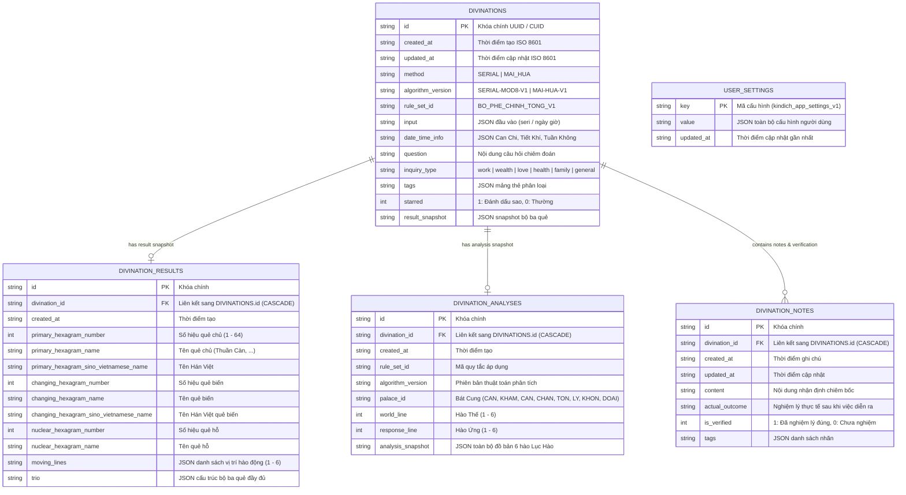

# THIẾT KẾ CƠ SỞ DỮ LIỆU & QUAN HỆ DỮ LIỆU
## Hệ thống Chiêm bốc & Dịch học Cổ pháp - Bắc Hà Tân An Phái
**Phiên bản tài liệu:** 1.0.0  
**Ngày cập nhật:** 31/10/2026  
**Công nghệ lưu trữ:** IndexedDB (Web qua Dexie), SQLite (Mobile & Desktop), Key-Value (Settings)

---

## 1. NGUYÊN TẮC THIẾT KẾ DỮ LIỆU (DATABASE PHILOSOPHY)

Hệ thống cơ sở dữ liệu của dự án KinhDich được thiết kế xoay quanh các nguyên tắc cốt lõi:
1. **Offline-First & Local-First:** Cơ sở dữ liệu nằm hoàn toàn trên thiết bị của người dùng, không phụ thuộc vào kết nối Internet hay API máy chủ trung gian.
2. **Tính Bất Biến của Quẻ (Snapshot Immutability):** Mỗi lần người dùng khởi quẻ và nhận được kết quả, toàn bộ đồ hình Lục Hào, quẻ chủ, quẻ biến, quẻ hỗ, can chi ngày giờ và kết quả phân tích ngũ hành được chụp nhanh (Snapshot) bất biến cùng với mã định danh bộ quy tắc (`rule_set_id`) và phiên bản thuật toán (`algorithm_version`). Điều này đảm bảo dữ liệu quá khứ không bao giờ bị sai lệch dù tương lai thuật toán hoặc diễn giải có cập nhật.
3. **Đồng Nhất Đa Nền Tảng (Cross-Platform Parity):** Cấu trúc bảng, tên trường, kiểu dữ liệu và mối quan hệ giữa các thực thể trên Web (IndexedDB) và Mobile/Desktop (SQLite) hoàn toàn tương thích 1-1, cho phép sao lưu và khôi phục dữ liệu qua lại liền mạch.
4. **Tối Ưu Hóa Truy Vấn & Chỉ Mục B-Tree:** Đẩy sâu các điều kiện lọc và phân trang xuống tầng SQL/Index engine, tránh tình trạng quét toàn bộ bảng vào bộ nhớ RAM.

---

## 2. SƠ ĐỒ THỰC THỂ QUAN HỆ (MERMAID ER DIAGRAM)



---

## 3. CHI TIẾT CÁC BẢNG DỮ LIỆU

### 3.1. Bảng `divinations` (Bản ghi khởi quẻ chính)
Là bảng trung tâm lưu giữ thông tin của mỗi lần lập quẻ.

| Cột | Kiểu SQLite | Kiểu Dexie / TS | Ràng buộc | Diễn giải |
| :--- | :--- | :--- | :--- | :--- |
| `id` | `TEXT` | `string` | `PRIMARY KEY` | Khóa chính ngẫu nhiên duy nhất (UUID) |
| `created_at` | `TEXT` | `string` | `NOT NULL` | Thời điểm lập quẻ theo chuẩn ISO 8601 |
| `updated_at` | `TEXT` | `string` | `NOT NULL` | Thời điểm cập nhật cuối cùng |
| `method` | `TEXT` | `CastingMethod` | `NOT NULL` | Phương pháp: `SERIAL` hoặc `MAI_HUA` |
| `algorithm_version` | `TEXT` | `string` | `NOT NULL` | Phiên bản thuật toán lập quẻ (`SERIAL-MOD8-V1`...) |
| `rule_set_id` | `TEXT` | `string` | `NOT NULL` | Bộ quy tắc phân tích (`BO_PHE_CHINH_TONG_V1`) |
| `input` | `TEXT` | `object (JSON)` | `NOT NULL` | Dữ liệu đầu vào: chuỗi seri hoặc thời điểm động tâm |
| `date_time_info` | `TEXT` | `object (JSON)` | `NOT NULL` | Thông tin lịch: Can Chi 4 trụ, Tiết Khí, Tuần Không |
| `question` | `TEXT` | `string` | `NULLABLE` | Câu hỏi chiêm bốc của người dùng |
| `inquiry_type` | `TEXT` | `QuestionCategory` | `NULLABLE` | Phân loại: `work`, `wealth`, `love`, `health`... |
| `tags` | `TEXT` | `string[] (JSON)` | `NULLABLE` | Mảng các nhãn gắn cho lần lập quẻ |
| `starred` | `INTEGER` | `boolean` | `DEFAULT 0` | 1 nếu đánh dấu yêu thích/quan trọng, 0 nếu không |
| `result_snapshot` | `TEXT` | `object (JSON)` | `NULLABLE` | Snapshot bất biến của bộ ba quẻ |

**Các chỉ mục (Indexes) trên `divinations`:**
- `idx_divinations_created_at ON divinations(created_at DESC)`: Sắp xếp lịch sử nhanh chóng.
- `idx_divinations_method_created ON divinations(method, created_at DESC)`: Lọc theo phương pháp.
- `idx_divinations_starred ON divinations(starred)`: Lọc nhanh các quẻ đánh dấu sao.
- `idx_divinations_rule_set_created ON divinations(rule_set_id, created_at DESC)`: Lọc theo bộ quy tắc.

### 3.2. Bảng `divination_results` (Kết quả quẻ chủ, biến, hỗ)
Lưu trữ thông tin chi tiết về bộ ba quẻ được lập.

| Cột | Kiểu SQLite | Kiểu Dexie / TS | Ràng buộc | Diễn giải |
| :--- | :--- | :--- | :--- | :--- |
| `id` | `TEXT` | `string` | `PRIMARY KEY` | Khóa chính |
| `divination_id` | `TEXT` | `string` | `FOREIGN KEY` | Khóa ngoại trỏ về `divinations.id` (`ON DELETE CASCADE`) |
| `created_at` | `TEXT` | `string` | `NOT NULL` | Thời điểm tạo |
| `primary_hexagram_number` | `INTEGER` | `number` | `NOT NULL` | Số thứ tự quẻ chủ (1 đến 64) |
| `primary_hexagram_name` | `TEXT` | `string` | `NOT NULL` | Tên thuần Việt của quẻ chủ |
| `primary_hexagram_sino_vietnamese_name`| `TEXT` | `string` | `NULLABLE` | Tên âm Hán của quẻ chủ |
| `changing_hexagram_number`| `INTEGER` | `number` | `NULLABLE` | Số thứ tự quẻ biến (nếu có hào động) |
| `changing_hexagram_name` | `TEXT` | `string` | `NULLABLE` | Tên quẻ biến |
| `nuclear_hexagram_number` | `INTEGER` | `number` | `NULLABLE` | Số thứ tự quẻ hỗ |
| `nuclear_hexagram_name` | `TEXT` | `string` | `NULLABLE` | Tên quẻ hỗ |
| `moving_lines` | `TEXT` | `number[] (JSON)`| `NOT NULL` | Danh sách các vị trí hào động (1..6) |
| `trio` | `TEXT` | `object (JSON)` | `NOT NULL` | Toàn bộ dữ liệu quái và hào của bộ ba quẻ |

### 3.3. Bảng `divination_analyses` (Đồ hình Lục Hào phân tích chuyên sâu)
Lưu trữ kết quả phân tích nạp giáp, ngũ hành sinh khắc, nhật nguyệt vượng suy.

| Cột | Kiểu SQLite | Kiểu Dexie / TS | Ràng buộc | Diễn giải |
| :--- | :--- | :--- | :--- | :--- |
| `id` | `TEXT` | `string` | `PRIMARY KEY` | Khóa chính |
| `divination_id` | `TEXT` | `string` | `FOREIGN KEY` | Khóa ngoại trỏ về `divinations.id` (`ON DELETE CASCADE`) |
| `created_at` | `TEXT` | `string` | `NOT NULL` | Thời điểm tạo |
| `rule_set_id` | `TEXT` | `string` | `NOT NULL` | Bộ quy tắc phân tích áp dụng |
| `algorithm_version` | `TEXT` | `string` | `NOT NULL` | Phiên bản động cơ phân tích |
| `palace_id` | `TEXT` | `string` | `NOT NULL` | Cung bản mệnh của quẻ trong Bát Cung |
| `world_line` | `INTEGER` | `number` | `NOT NULL` | Vị trí hào Thế (1..6) |
| `response_line` | `INTEGER` | `number` | `NOT NULL` | Vị trí hào Ứng (1..6) |
| `analysis_snapshot` | `TEXT` | `object (JSON)` | `NOT NULL` | Snapshot toàn diện 6 hào kèm Lục Thú, Lục Thân |

### 3.4. Bảng `divination_notes` (Ghi chú & Nghiệm lý thực tế)
Quản lý các suy nghĩ cá nhân, câu hỏi bổ sung và kết quả ứng nghiệm trong thực tế.

| Cột | Kiểu SQLite | Kiểu Dexie / TS | Ràng buộc | Diễn giải |
| :--- | :--- | :--- | :--- | :--- |
| `id` | `TEXT` | `string` | `PRIMARY KEY` | Khóa chính |
| `divination_id` | `TEXT` | `string` | `FOREIGN KEY` | Khóa ngoại trỏ về `divinations.id` (`ON DELETE CASCADE`) |
| `created_at` | `TEXT` | `string` | `NOT NULL` | Thời điểm tạo ghi chú |
| `updated_at` | `TEXT` | `string` | `NOT NULL` | Thời điểm cập nhật cuối |
| `content` | `TEXT` | `string` | `NOT NULL` | Nội dung ghi chú, luận đoán ban đầu |
| `actual_outcome` | `TEXT` | `string` | `NULLABLE` | Kết quả diễn biến sự việc ngoài đời thực |
| `is_verified` | `INTEGER` | `boolean` | `DEFAULT 0` | 1 nếu đã đối chiếu nghiệm lý, 0 nếu chưa |
| `tags` | `TEXT` | `string[] (JSON)`| `NULLABLE` | Các nhãn phân loại bổ sung |

### 3.5. Bảng `user_settings` (Cấu hình cá nhân)
Lưu trữ các tùy biến người dùng về giao diện, phương pháp lập quẻ và lịch pháp.

| Cột | Kiểu | Ràng buộc | Diễn giải |
| :--- | :--- | :--- | :--- |
| `key` | `TEXT` | `PRIMARY KEY` | Khóa định danh (`kindich_app_settings_v1`) |
| `value` | `TEXT / JSON` | `NOT NULL` | Dữ liệu JSON `KinhDichSettings` |
| `updated_at` | `TEXT` | `NOT NULL` | Thời điểm cập nhật cấu hình |

---

## 4. CHIẾN LƯỢC MIGRATION & NÂNG CẤP PHIÊN BẢN SCHEMA

Hệ thống quản lý phiên bản cơ sở dữ liệu chặt chẽ qua bảng metadata `schema_migrations`:
- **Phiên bản 1 (v1):** Khởi tạo cấu trúc bảng cơ sở (`divinations`, `divination_results`, `divination_analyses`, `divination_notes`).
- **Phiên bản 2 (v2):** Bổ sung các chỉ mục hợp chất (`idx_divinations_method_created`, `idx_divinations_created_at`, `idx_divinations_starred`), bổ sung trường `rule_set_id`, `starred` vào `divinations` và `is_verified` vào `divination_notes`. Tự động điền giá trị mặc định cho các bản ghi cũ khi chạy migration.
- **Phiên bản 3 (v3 - Dexie):** Bổ sung bảng `user_settings` phục vụ lưu trữ cấu hình offline.

---

## 5. ĐỊNH DẠNG SAO LƯU & KHÔI PHỤC (JSON SPECIFICATION)

Tệp sao lưu chuẩn có cấu trúc:
```json
{
  "version": "1.0.0",
  "exportedAt": "2026-10-31T10:30:00.000Z",
  "appVersion": "0.1.0",
  "schemaVersion": 2,
  "data": {
    "divinations": [ ... ],
    "divination_results": [ ... ],
    "divination_analyses": [ ... ],
    "divination_notes": [ ... ],
    "user_settings": [ ... ]
  },
  "checksum": "sha256_hash_here"
}
```
**Quy tắc xử lý xung đột khi Khôi phục:**
- **Ghi đè (Overwrite):** Bản ghi trùng ID trong file sao lưu sẽ thay thế bản ghi hiện có.
- **Bỏ qua (Skip):** Nếu ID đã tồn tại trên thiết bị, giữ nguyên dữ liệu hiện tại, chỉ thêm các bản ghi mới.
- **Nhân bản / Đổi tên (Clone/Rename):** Tạo ID mới cho bản ghi nhập vào để bảo toàn cả hai bản ghi.
