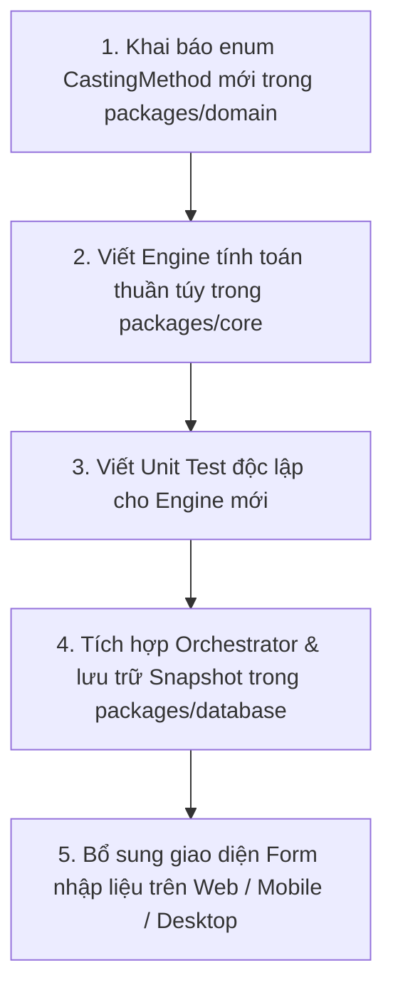

# HƯỚNG DẪN PHÁT TRIỂN & CHẠY DỰ ÁN (DEVELOPMENT GUIDE)
## Dự án: Kinh Dịch - Bắc Hà Tân An Phái
**Phiên bản tài liệu:** 1.0.0  
**Ngày cập nhật:** 31/10/2026

---

## 1. KHỞI CHẠY MÔI TRƯỜNG PHÁT TRIỂN (DEVELOPMENT SERVERS)

Hệ thống hỗ trợ chạy độc lập từng nền tảng hoặc chạy song song:

### 1.1. Chạy Ứng dụng Web (PWA)
Khởi động máy chủ phát triển Vite với Hot Module Replacement (HMR):
```bash
# Từ thư mục gốc:
pnpm --filter web dev

# Hoặc:
cd apps/web
pnpm dev
```
- **Địa chỉ truy cập:** `http://localhost:3000` (hoặc địa chỉ IP cục bộ hiển thị trên terminal).
- Ứng dụng hỗ trợ kiểm thử PWA ngoại tuyến ngay trong trình duyệt.

### 1.2. Chạy Ứng dụng Desktop Windows (Tauri 2)
Khởi động cửa sổ ứng dụng Windows native kết hợp Vite dev server:
```bash
# Từ thư mục gốc:
pnpm --filter desktop desktop:dev

# Hoặc:
cd apps/desktop
pnpm tauri dev
```
- Cửa sổ ứng dụng máy tính sẽ tự động mở lên với kích thước mặc định 1200x800, tích hợp thanh Menu Bar native và cơ sở dữ liệu SQLite cục bộ.

### 1.3. Chạy Ứng dụng Di Động (Mobile Expo)
Khởi động Metro Bundler của Expo:
```bash
# Từ thư mục gốc:
pnpm --filter mobile start

# Hoặc:
cd apps/mobile
npx expo start
```
**Cách xem trên thiết bị:**
- **Điện thoại thật:** Mở ứng dụng **Expo Go** trên Android/iOS, quét mã QR hiển thị trên màn hình terminal (yêu cầu điện thoại và máy tính kết nối cùng mạng Wi-Fi).
- **Android Emulator:** Nhấn phím `a` trên bàn phím terminal.
- **iOS Simulator:** Nhấn phím `i` trên bàn phím terminal (chỉ khả dụng trên macOS).

---

## 2. QUY CHUẨN MÃ NGUỒN (CODING CONVENTIONS)

1. **TypeScript Strict Mode:**
   - Tuyệt đối không sử dụng `any` không có lý do xác đáng. Mọi kiểu dữ liệu hào, quái, cung bản mệnh phải dùng union type hoặc enum rõ ràng.
   - Bật cờ `noImplicitReturns`, `strictNullChecks`, `noUnusedLocals`.
2. **Nguyên tắc Bảo Toàn Tri Thức Cổ Pháp (Academic Integrity):**
   - Không tự ý sửa đổi công thức tính nạp giáp, hào thế ứng hay vượng suy trong `@kindich/domain` và `@kindich/core` khi phát hiện kết quả khác suy đoán cá nhân. Phải kiểm tra và đối chiếu cổ bản trước.
   - Toàn bộ các mảng dữ liệu tra cứu (`HEXAGRAMS`, `TRIGRAMS`, `PALACES`, `BAGONG_MAP`, `NAJIA_MAP`) đều được đóng băng dạng `readonly` / `as const`.
3. **Phân tách Trách nhiệm (Single Responsibility):**
   - Các Component trong `apps/` chỉ phụ trách hiển thị UI và lắng nghe sự kiện người dùng, **tuyệt đối không viết lại thuật toán tính toán Kinh Dịch trong UI**.
   - Mọi tính toán phải gọi hàm từ `@kindich/core` hoặc `@kindich/calendar`.

---

## 3. QUY TRÌNH THÊM PHƯƠNG PHÁP LẬP QUẺ MỚI (MỞ RỘNG NGHIỆP VỤ)

Hệ thống được thiết kế theo nguyên lý **Open-Closed Principle** (Mở để mở rộng, Đóng để sửa đổi):



1. **Bước 1:** Bổ sung giá trị enum mới trong `packages/domain/src/enums/casting-method.enum.ts` (ví dụ: `CO_THI` cho phép cỏ thi).
2. **Bước 2:** Tạo thư mục engine mới trong `packages/core/src/co-thi/` và viết hàm thuần túy `castByCoThi(...)`.
3. **Bước 3:** Viết unit test bao phủ toàn bộ các trường hợp biên trong `packages/core/src/co-thi/co-thi.casting.spec.ts`.
4. **Bước 4:** Tạo form UI tương ứng trong `apps/` kết nối với `orchestrateSixYaoAnalysis`.

---

## 4. HƯỚNG DẪN ĐÓNG GÓI BẢN PHÁT HÀNH (PRODUCTION BUILD)

### 4.1. Đóng gói Web (PWA Static Assets)
```bash
cd apps/web
pnpm build
```
- Kết quả xuất ra tại `apps/web/dist/`.
- Sẵn sàng tải lên bất kỳ máy chủ tĩnh nào (Vercel, Cloudflare Pages, Netlify, Nginx, GitHub Pages).

### 4.2. Đóng gói Desktop (Windows Installer)
```bash
cd apps/desktop
pnpm tauri build
```
- Kết quả xuất ra tại `apps/desktop/src-tauri/target/release/bundle/msi/` hoặc `nsis/` (file cài đặt `.msi` hoặc `.exe` độc lập).

### 4.3. Đóng gói Mobile (APK / AAB)
Sử dụng Expo Application Services (EAS):
```bash
cd apps/mobile
# Tạo file APK cài đặt trực tiếp trên Android:
npx eas build -p android --profile preview
```
