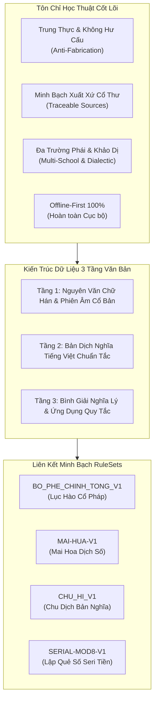
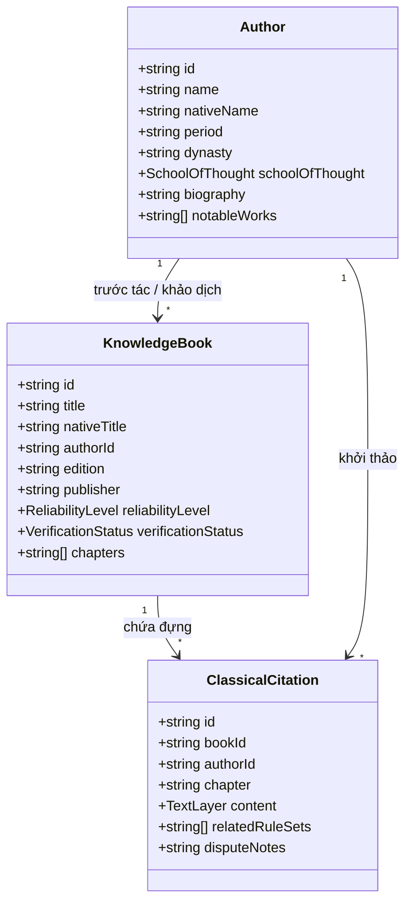

# QUẢN LÝ NGUỒN TRI THỨC KINH ĐIỂN (KNOWLEDGE SOURCE MANAGEMENT)
## Dự án: Kinh Dịch - Bắc Hà Tân An Phái
**Phiên bản tài liệu:** 1.0.0  
**Ngày cập nhật:** 31/10/2026  
**Trạng thái hệ thống:** Đã tích hợp trọn vẹn trong Codebase & Giao diện ứng dụng (Offline-First)

---

## 1. TÔN CHỈ & NGUYÊN TẮC QUẢN TRỊ TRI THỨC

Hệ thống Quản lý Nguồn Tri thức (Knowledge Source Management) của dự án Kinh Dịch - Bắc Hà Tân An Phái được thiết kế nhằm giải quyết triệt để tình trạng trích dẫn sai lệch, hư cấu nội dung hoặc trộn lẫn tùy tiện giữa các trường phái Dịch học trong kỷ nguyên số.



### 1.1. Cam kết chống hư cấu (Anti-Fabrication Constraint)
- Tuyệt đối **không tự tạo trích dẫn**, không gán ghép lời cổ nhân nếu không có căn cứ văn bản cổ.
- Mọi câu trích dẫn trong hệ thống (`ClassicalCitation`) bắt buộc phải liên kết trực tiếp với:
  1. Một tác giả cụ thể (`Author`) trong danh mục lịch sử.
  2. Một pho thư tịch cụ thể (`KnowledgeBook`) kèm niên đại và ấn bản lưu trữ.
  3. Quyển, chương, thiên, tiết mục và số trang (nếu có trong bản in tiêu chuẩn).

### 1.2. Hoạt động ngoại tuyến 100% (Offline-First)
- Toàn bộ danh mục tác giả, sách cổ và kinh văn được nhúng cục bộ trong `@kindich/domain`, không cần bất kỳ kết nối mạng nào để tra cứu.
- Hỗ trợ tìm kiếm toàn văn siêu tốc (chữ Hán, Hán Việt, tiếng Việt, thuật ngữ) thông qua `InMemoryKnowledgeRepository`.

---

## 2. CẤU TRÚC 3 TẦNG VĂN BẢN (THREE-LAYER TEXT ARCHITECTURE)

Mỗi nội dung kinh điển trong hệ thống được cấu trúc đồng bộ theo 3 tầng văn bản độc lập nhưng gắn kết chặt chẽ:

| Tầng | Tên gọi | Phạm vi dữ liệu | Mục đích học thuật |
| :--- | :--- | :--- | :--- |
| **Tầng 1** | **Nguyên văn Chữ Hán & Phiên âm** | Chữ Hán chính thể (Phồn thể) và Phiên âm Hán Việt chuẩn mực | Bảo tồn tính chân xác của cổ bản, phục vụ nghiên cứu cổ văn và đối chiếu dị bản Hán Nôm. |
| **Tầng 2** | **Bản dịch nghĩa Quốc ngữ** | Dịch nghĩa tiếng Việt trung thực, sát nguyên văn của các dịch gia hàng đầu | Giúp người học nắm bắt chuẩn xác văn ý mà không bị bóp méo hay hiện đại hóa quá đà. |
| **Tầng 3** | **Bình giải & Ứng dụng RuleSet** | Giải thích nghĩa lý biểu trưng, triết lý nhân sinh và quy tắc vận hành thuật toán | Kết nối trực tiếp giữa kinh văn cổ điển với các module tính toán kỹ thuật trong ứng dụng. |

---

## 3. HỆ THỐNG PHÂN CẤP ĐỘ TIN CẬY & TRẠNG THÁI XÁC MINH

Nhằm đảm bảo sự minh bạch học thuật tuyệt đối, mọi tư liệu đều được gắn nhãn định danh rõ ràng:

### 3.1. Cấp độ tin cậy (`ReliabilityLevel`)
1. **`canonical` (Chính Kinh - Tối thượng):**
   - Các tác phẩm thuộc hàng Thánh kinh Dịch học: *Chu Dịch Chính Nghĩa* (Văn Vương, Chu Công, Khổng Tử) và *Kinh Thị Dịch Truyện* (Kinh Phòng).
2. **`standard` (Chính Truyền - Kinh điển tiêu chuẩn):**
   - Các tác phẩm kinh điển được toàn thể giới Dịch học thừa nhận qua nhiều thế kỷ: *Bốc Phệ Chính Tông* (Vương Duy Đức), *Tăng San Bốc Dịch* (Dã Hạc Đạo Nhân), *Mai Hoa Dịch Số* (Thiệu Ung), *Chu Dịch Bản Nghĩa* (Chu Hi).
3. **`commentary` (Khảo Cứu & Chú Giải - Tham khảo cao):**
   - Các công trình biên soạn, dịch giải uy tín thời cận - hiện đại: *Kinh Dịch - Đạo của người quân tử* (Nguyễn Hiến Lê), *Bắc Hà Tân An Dịch Học Chỉ Nam* (Cụ Bắc Hà).
4. **`unverified` (Chưa Khảo Dị):**
   - Tài liệu sao chép truyền miệng hoặc dị bản dân gian chưa qua đối chiếu thư viện.

### 3.2. Trạng thái xác minh (`VerificationStatus`)
- **`verified` (Đã xác minh):** Đã đối soát trực tiếp giữa văn bản số và bản in Hán Nôm tiêu chuẩn (Đường bản, Tứ Khố bản, Khang Hy bản).
- **`under_review` (Đang rà soát):** Đang trong quá trình hiệu đính câu chữ hoặc dị tự cổ.
- **`disputed` (Có khảo dị học thuật):** Có sự khác biệt quan điểm hoặc cách tính toán giữa các trường phái lớn (được ghi rõ trong `disputeNotes`).

---

## 4. DANH MỤC TÁC GIẢ KINH ĐIỂN (10 CANONICAL AUTHORS)



| ID | Danh nhân Dịch học | Tên chữ Hán | Thời kỳ / Triều đại | Trường phái | Tác phẩm tiêu biểu |
| :--- | :--- | :--- | :--- | :--- | :--- |
| `author_king_wen` | **Chu Văn Vương** (Cơ Xương) | 周文王 (姬昌) | Tây Chu (TK XI TCN) | Nghĩa Lý Phái | *Chu Dịch Thoán Từ (Quái Từ)* |
| `author_duke_of_zhou` | **Chu Công** (Cơ Đán) | 周公 (姬旦) | Tây Chu (TK XI TCN) | Nghĩa Lý Phái | *Chu Dịch Hào Từ*, *Chu Lễ* |
| `author_confucius` | **Khổng Tử** (Khổng Khâu) | 孔子 (孔丘) | Xuân Thu (551 - 479 TCN) | Nghĩa Lý Phái | *Thập Dực (Mười cánh chim)* |
| `author_jing_fang` | **Kinh Phòng** (Kinh Quân Minh) | 京房 (京君明) | Tây Hán (77 - 37 TCN) | Lục Hào Phái | *Kinh Thị Dịch Truyện* |
| `author_shao_yong` | **Thiệu Ung** (Thiệu Khang Tiết) | 邵雍 (邵康節) | Bắc Tống (1011 - 1077) | Tượng Số Phái | *Mai Hoa Dịch Số*, *Hoàng Cực Kinh Thế* |
| `author_zhu_xi` | **Chu Hi** (Chu Nguyên Hối) | 朱熹 (朱元晦) | Nam Tống (1130 - 1200) | Nghĩa Lý Phái | *Chu Dịch Bản Nghĩa*, *Dịch Học Khải Mông* |
| `author_wang_wei_de` | **Vương Duy Đức** (Vương Hồng Húc) | 王維德 (王洪緒) | Thanh Triều (TK XVII-XVIII) | Lục Hào Phái | *Bốc Phệ Chính Tông (14 quyển)* |
| `author_ye_he` | **Dã Hạc Đạo Nhân** | 野鶴老人 | Thanh Triều (Khang Hy) | Lục Hào Phái | *Tăng San Bốc Dịch (4 quyển)* |
| `author_nguyen_hien_le`| **Nguyễn Hiến Lê** | 阮憲黎 | Hiện đại (1912 - 1984) | Nghĩa Lý Phái | *Kinh Dịch - Đạo của người quân tử* |
| `author_bac_ha` | **Cụ Bắc Hà** (Dịch Học Danh Gia) | 北河易學名家 | Thế kỷ XIX - XX | Cổ Pháp Bắc Hà | *Bắc Hà Tân An Dịch Học Chỉ Nam* |

---

## 5. DANH MỤC THƯ TỊCH CỔ ĐIỂN (8 CANONICAL BOOKS)

| ID | Tên Thư Tịch | Chữ Hán | Tác giả | Bản khắc in / Ấn bản | Cấp độ | Trạng thái |
| :--- | :--- | :--- | :--- | :--- | :--- | :--- |
| `book_zhouyi_zhengyi` | **Chu Dịch Chính Nghĩa** | 周易正義 | Khổng Dĩnh Đạt | Thập Tam Kinh Chú Sớ bản (14 quyển) | `canonical` | `verified` |
| `book_jingshi_yizhuan` | **Kinh Thị Dịch Truyện** | 京氏易傳 | Kinh Phòng | Tứ Khố Toàn Thư bản (3 quyển) | `canonical` | `verified` |
| `book_bushi_zhengzong` | **Bốc Phệ Chính Tông** | 卜筮正宗 | Vương Duy Đức | Cổ Hương Trai bản khắc Càn Long (14 quyển) | `standard` | `verified` |
| `book_zengshan_buyi` | **Tăng San Bốc Dịch** | 增刪卜易 | Dã Hạc Đạo Nhân | Lý Văn Huy Khang Hy bản (4 quyển) | `standard` | `verified` |
| `book_meihua_yishu` | **Mai Hoa Dịch Số** | 梅花易數 | Thiệu Ung | Cổ Học Tùng Thư bản Đạo Quang (5 quyển) | `standard` | `verified` |
| `book_zhouyi_benyi` | **Chu Dịch Bản Nghĩa** | 周易本義 | Chu Hi | Tùng Giang Thư Viện bản (4 quyển) | `standard` | `verified` |
| `book_kinh_dich_nhl` | **Kinh Dịch - Đạo Quân Tử** | 周易君子之道 | Nguyễn Hiến Lê | NXB Văn học (Khảo dịch hiện đại) | `commentary`| `verified` |
| `book_bac_ha_chi_nam` | **Bắc Hà Tân An Dịch Học Chỉ Nam**| 北河新安指南 | Cụ Bắc Hà | Bản chép tay Hán Nôm môn phái | `commentary`| `verified` |

---

## 6. MA TRẬN ÁNH XẠ TRÍCH DẪN KINH ĐIỂN VỚI RULESETS

Bảng dưới đây chứng minh xuất xứ học thuật của từng quy tắc đang vận hành trong Codebase:

| Mã Trích Dẫn (`id`) | Chủ đề trích dẫn | Thư tịch & Tác giả | Tầng 1 (Chữ Hán Cổ Điển) | RuleSets Liên Kết | Trạng thái |
| :--- | :--- | :--- | :--- | :--- | :--- |
| `cite_can_thoan_tu` | Thoán từ Thuần Càn | *Chu Dịch Chính Nghĩa* (Văn Vương) | 乾：元，亨，利，貞。 | `RULESET-DEFAULT`<br/>`CHU_HI_V1` | `verified` |
| `cite_can_dai_tuong` | Đại Tượng Thuần Càn | *Chu Dịch Chính Nghĩa* (Khổng Tử) | 天行健，君子以自強不息。 | `RULESET-DEFAULT`<br/>`CHU_HI_V1` | `verified` |
| `cite_can_so_cuu` | Hào từ Sơ Cửu Càn | *Chu Dịch Chính Nghĩa* (Chu Công) | 初九：潛龍，勿用。 | `RULESET-DEFAULT`<br/>`CHU_HI_V1` | `verified` |
| `cite_khon_thoan_tu` | Thoán từ Thuần Khôn| *Chu Dịch Chính Nghĩa* (Văn Vương) | 坤：元，亨，利牝馬之貞。 | `RULESET-DEFAULT`<br/>`CHU_HI_V1` | `verified` |
| `cite_bat_cung_kinh_phong`| Định vị Bát Cung & Thế Ứng | *Kinh Thị Dịch Truyện* (Kinh Phòng) | 分八宮，每宮統八卦。世應定位... | `BO_PHE_CHINH_TONG_V1`<br/>`RULESET-LUC-HAO-STANDARD` | `verified` |
| `cite_nap_giap_can_khon` | Khẩu quyết Nạp Giáp Can Chi | *Bốc Phệ Chính Tông* (Vương Duy Đức) | 乾金甲子外壬午，坤土乙未癸丑連... | `BO_PHE_CHINH_TONG_V1`<br/>`RULESET-LUC-HAO-STANDARD` | `verified` |
| `cite_luc_than_ngu_hanh` | Phối Ngũ Hành Lục Thân | *Bốc Phệ Chính Tông* (Vương Duy Đức) | 生我者為父母，我生者為子孫... | `BO_PHE_CHINH_TONG_V1`<br/>`RULESET-LUC-HAO-STANDARD` | `verified` |
| `cite_luc_thu_khoi` | Khởi Lục Thú Can ngày | *Tăng San Bốc Dịch* (Dã Hạc) | 甲乙起青龍，丙丁起朱雀... | `BO_PHE_CHINH_TONG_V1`<br/>`RULESET-LUC-HAO-STANDARD` | `verified` |
| `cite_tuan_khong_chan_gia`| Biện luận Tuần Không (Chân/Giả) | *Tăng San Bốc Dịch* (Dã Hạc) | 旬空者，神之不在也。旺相之空... | `BO_PHE_CHINH_TONG_V1`<br/>`RULESET-LUC-HAO-STANDARD` | `disputed` ⚠️ |
| `cite_mai_hua_the_dung` | Phép phân Thể Dụng Mai Hoa | *Mai Hoa Dịch Số* (Thiệu Ung) | 卦成必分體用，不動為體，動爻為用... | `MAI-HUA-V1` | `verified` |
| `cite_chu_hi_doan_que` | Đoán quẻ biến hào Chu Hi | *Chu Dịch Bản Nghĩa* (Chu Hi) | 六爻皆不變，則以本卦彖辭占... | `CHU_HI_V1` | `verified` |
| `cite_serial_mod8_am_duong`| Toán học Âm Dương Seri Tiền | *Bắc Hà Tân An Chỉ Nam* (Cụ Bắc Hà) | 奇數位陽為天...偶數位陰為地... | `SERIAL-MOD8-V1`<br/>`BO_PHE_CHINH_TONG_V1` | `verified` |
| `cite_gio_ty_da_chinh` | Ranh giới chuyển ngày giờ Tý | *Bắc Hà Tân An Chỉ Nam* (Cụ Bắc Hà) | 子時跨夜...亥末子初即二十三點開子... | `BO_PHE_CHINH_TONG_V1`<br/>`MAI-HUA-V1` | `disputed` ⚠️ |

---

## 7. CÁC ĐIỂM KHẢO DỊ HỌC THUẬT & HƯỚNG XỬ LÝ (ACADEMIC DISPUTES)

Hệ thống Bắc Hà Tân An chủ trương không che giấu sự dị biệt giữa các môn phái mà minh bạch hóa bằng công nghệ:

### 7.1. Khảo dị 1: Ranh giới chuyển ngày Giờ Tý (23:00 vs 00:00)
- **Vấn đề học thuật:**
  * Cổ pháp Thiên văn & Dịch học phương Đông: Dương khí bắt đầu manh nha từ đầu giờ Tý (23:00 đêm hôm trước), do đó Can Chi của ngày phải đổi từ 23:00.
  * Thói quen hành chính phương Tây: Ngày mới bắt đầu từ đúng 00:00 đêm. Một số học giả phân biệt *Dạ Tý (23:00 - 24:00)* giữ Can ngày cũ và *Tảo Tý (00:00 - 01:00)* đổi Can ngày mới.
- **Giải pháp xử lý:**
  * Được cấu hình trong **Settings Module** (`calendar.dayTransitionRule`).
  * Mặc định sử dụng cổ pháp thiên văn `23:00` (*Chuẩn Bắc Hà*), đồng thời hỗ trợ chuyển sang `00:00` cho người dùng có nhu cầu khảo nghiệm.

### 7.2. Khảo dị 2: Tuần Không - Chân Không vs Giả Không & Ám Động
- **Vấn đề học thuật:**
  * Một số trường phái xem Tuần Không như là hoàn toàn vô dụng, mọi sự chiêm đoán trong tuần đó đều hỏng.
  * Phái thực nghiệm Dã Hạc (*Tăng San Bốc Dịch*) phân biệt rạch ròi: Nếu hào rơi vào Tuần Không mà được Nguyệt Kiến, Nhật Thần sinh phù vượng tướng thì là **Giả Không**, ra khỏi tuần sẽ thành sự; nếu bị Nhật Thần xung vào hào vượng Không thì kích động biến thành **Ám Động** (rất hữu lực).
- **Giải pháp xử lý:**
  * Đồ bản Lục Hào hiển thị rõ ràng nhãn `CHAN_KHONG` hoặc `GIA_KHONG` kèm lý giải nguyên nhân sinh khắc cụ thể trên từng hào.

### 7.3. Khảo dị 3: Trọng tâm kinh văn khi có 4 hoặc 5 hào động
- **Vấn đề học thuật:**
  * Chu Hi (*Chu Dịch Bản Nghĩa*): Khi có 4 hào biến, lấy hào tĩnh ở dưới của quẻ biến làm chủ; khi có 5 hào biến, lấy hào tĩnh duy nhất của quẻ biến làm chủ.
  * Dã Hạc Đạo Nhân (*Tăng San Bốc Dịch*): Trong môn Bốc Dịch Lục Hào, chỉ hào nào phát động thì hào đó mới sinh khắc Dụng Thần, không cần tra cứu hào tĩnh quẻ biến.
- **Giải pháp xử lý:**
  * Tách biệt rõ ràng trên giao diện: Tab *Kinh văn cổ điển (Chu Dịch)* hiển thị theo quy tắc Chu Hi; Tab *Phân tích Lục Hào* hiển thị theo quan hệ Dụng Thần ngũ hành của Dã Hạc.

---

## 8. HƯỚNG DẪN MỞ RỘNG VÀ QUẢN TRỊ DỮ LIỆU TRI THỨC

### 8.1. Cấu trúc Interface `IKnowledgeRepository`
Kho tri thức được truy xuất thông qua giao diện lập trình hướng đối tượng chuẩn mực:

```typescript
export interface IKnowledgeRepository {
  getAuthors(): Promise<readonly Author[]>;
  getAuthorById(id: string): Promise<Author | null>;
  getBooks(filter?: KnowledgeFilterOptions): Promise<readonly KnowledgeBook[]>;
  getBookById(id: string): Promise<KnowledgeBook | null>;
  getCitations(filter?: KnowledgeFilterOptions): Promise<readonly ClassicalCitation[]>;
  getCitationById(id: string): Promise<ClassicalCitation | null>;
  getCitationsByRuleSet(ruleSetId: string): Promise<readonly ClassicalCitation[]>;
  searchCitations(keyword: string): Promise<readonly ClassicalCitation[]>;
  getStatistics(): Promise<KnowledgeStatistics>;
}
```

### 8.2. Kiểm thử bảo đảm chất lượng (Anti-Fabrication Test Suite)
Mọi dữ liệu tri thức mới thêm vào phải vượt qua bộ kiểm thử tự động tại `packages/domain/src/knowledge/knowledge.spec.ts`:
- Kiểm tra tính đầy đủ của 10 tác giả danh nhân.
- Kiểm tra tính hợp lệ của khóa ngoại `authorId` và `bookId` cho từng trích dẫn.
- Bắt buộc phải có đủ 3 tầng văn bản không rỗng (`original`, `sinoVietnamese`, `translation`, `explanation`).
- Bắt buộc phải có `disputeNotes` nếu trạng thái là `disputed`.

---

## 9. KẾT LUẬN

Hệ thống Quản lý Nguồn Tri Thức (Knowledge Source Management) không chỉ là một tính năng phần mềm mà còn là lời khẳng định về **sự liêm chính học thuật** và **tinh thần phụng sự cổ học** của dự án Bắc Hà Tân An Phái. Việc chuẩn hóa dữ liệu thư tịch, phân định rõ ràng 3 tầng văn bản và công khai các điểm khảo dị giúp người dùng hoàn toàn yên tâm khi chiêm nghiệm và ứng dụng Kinh Dịch trong đời sống hiện đại.
