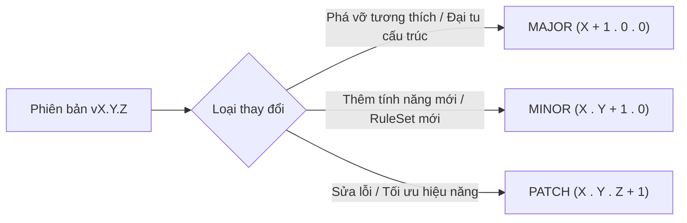
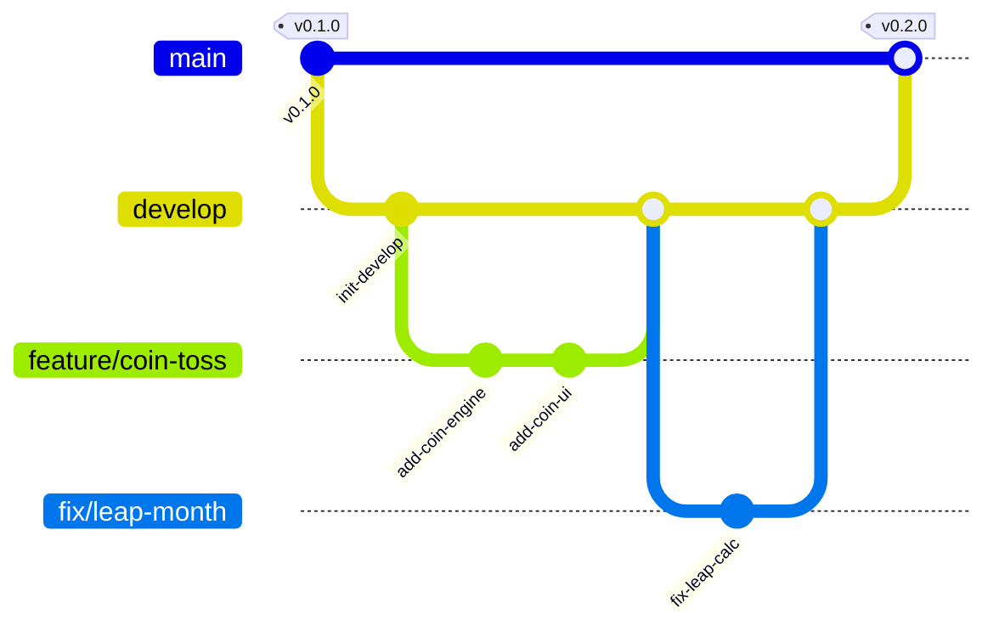
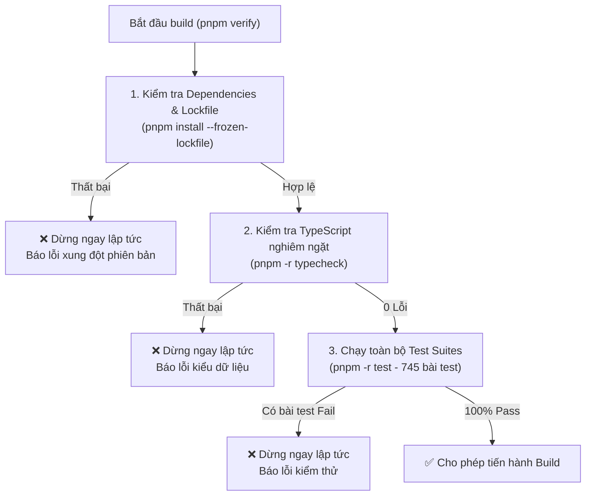

# QUY TRÌNH QUẢN LÝ PHIÊN BẢN VÀ PHÁT HÀNH (RELEASE WORKFLOW)
## Dự án: Kinh Dịch - Bắc Hà Tân An Phái

Tài liệu này quy định tiêu chuẩn quản lý phiên bản, phân nhánh Git, kiểm tra chất lượng tự động trước khi đóng gói và quy trình phát hành đa nền tảng cho dự án **Kinh Dịch - Bắc Hà Tân An Phái** (Web, Android, iOS, Windows).

---

## 1. Nguyên Tắc Semantic Versioning (SemVer 2.0.0)

Dự án áp dụng chặt chẽ quy chuẩn **Semantic Versioning** định dạng:
$$\text{MAJOR}.\text{MINOR}.\text{PATCH}$$



### 1.1. Tiêu chí xác định loại phiên bản
1. **MAJOR (X.0.0)**:
   - Thay đổi phá vỡ tính tương thích ngược (Breaking Changes) trong Core Engine hoặc Public APIs.
   - Nâng cấp cấu trúc cơ sở dữ liệu đòi hỏi migration lớn không thể khôi phục định dạng cũ.
   - Thay đổi căn bản về triết lý luận giải hoặc thay đổi cấu trúc dữ liệu xuất khẩu/nhập khẩu JSON.
2. **MINOR (X.Y.0)**:
   - Bổ sung phương pháp lập quẻ mới (ví dụ: lập quẻ 3 đồng xu gieo 6 lần, cỏ thi cổ pháp).
   - Bổ sung bộ quy tắc RuleSet mới (ví dụ: bổ sung khảo dị Dã Hạc Lão Nhân).
   - Thêm nền tảng mới hoặc tính năng mới trong Settings mà vẫn bảo toàn tương thích ngược 100%.
3. **PATCH (X.Y.Z)**:
   - Sửa lỗi thuật toán hiển thị, xử lý lỗi ngày giờ, sửa lỗi layout UI/UX.
   - Tối ưu hóa hiệu năng (code-splitting, index database, singleton buffer).
   - Nâng cấp các gói phụ thuộc bảo mật hoặc cập nhật tài liệu kỹ thuật.

### 1.2. Công cụ tự động đồng bộ phiên bản (`bump-version.mjs`)
Dự án cung cấp script tự động đồng bộ phiên bản trên toàn bộ **9 workspaces** và các tệp cấu hình nền tảng:
```bash
# Nâng phiên bản bản vá (0.1.0 -> 0.1.1)
pnpm version:bump patch

# Nâng phiên bản tính năng (0.1.0 -> 0.2.0)
pnpm version:bump minor

# Nâng phiên bản đột phá (0.1.0 -> 1.0.0)
pnpm version:bump major

# Hoặc đặt phiên bản cụ thể
pnpm version:bump 0.2.5
```

**Các tệp được tự động đồng bộ hóa:**
- Root `package.json`
- `packages/*/package.json` (`shared`, `domain`, `calendar`, `core`, `database`)
- `apps/*/package.json` (`web`, `desktop`, `mobile`)
- `apps/mobile/app.json` (`expo.version`)
- `apps/desktop/src-tauri/tauri.conf.json` (`version`)
- `apps/desktop/src-tauri/Cargo.toml` (`[package] version`)
- `CHANGELOG.md` & `docs/CHANGELOG.md` (tự động tạo tiêu đề phiên bản)

---

## 2. Chuẩn Hóa Phân Nhánh Git (Git Branching Strategy)

Dự án áp dụng mô hình nhánh rút gọn từ Git Flow nhằm đảm bảo tính ổn định tối đa cho bản phát hành:



### 2.1. Quy định các nhánh chính
| Tên nhánh | Mục đích | Quyền hạn & Quy tắc |
|---|---|---|
| `main` | Bản phát hành chính thức, ổn định tuyệt đối (Production). | Chỉ nhận merge từ `develop` qua Pull Request sau khi vượt qua 100% CI. Luôn được gắn Git Tag tương ứng (`vX.Y.Z`). |
| `develop` | Nhánh tích hợp chính dành cho quá trình phát triển (Staging). | Nhận merge từ các nhánh `feature/*` và `fix/*`. Mọi commit trên develop phải đảm bảo `pnpm verify` vượt qua. |
| `feature/*` | Nhánh phát triển tính năng mới. | Tách từ `develop`, đặt tên theo cú pháp `feature/<ten-tinh-nang>` (ví dụ: `feature/coin-casting`, `feature/pdf-export`). |
| `fix/*` | Nhánh sửa lỗi chức năng. | Tách từ `develop` (hoặc từ `main` nếu là hotfix khẩn cấp), đặt tên theo cú pháp `fix/<ma-loi-hoac-noi-dung>` (ví dụ: `fix/sqlite-schema`, `fix/dark-mode`). |

### 2.2. Quy chuẩn thông điệp Commit (Conventional Commits)
Thông điệp commit phải tuân thủ định dạng chuẩn quốc tế:
- `feat: <mô tả>` - Bổ sung tính năng mới.
- `fix: <mô tả>` - Sửa lỗi chương trình.
- `docs: <mô tả>` - Bổ sung hoặc chỉnh sửa tài liệu.
- `perf: <mô tả>` - Tối ưu hóa hiệu năng, dung lượng.
- `test: <mô tả>` - Viết thêm hoặc sửa đổi kiểm thử.
- `refactor: <mô tả>` - Tái cấu trúc mã nguồn không thay đổi hành vi nghiệp vụ.
- `chore: <mô tả>` - Cập nhật build script, dependency, cấu hình dự án.

---

## 3. Quy Chuẩn Quản Lý Nhật Ký Thay Đổi (CHANGELOG.md)

Nhật ký thay đổi được duy trì song song tại thư mục gốc [CHANGELOG.md](file:///E:/bac-ha-tan-an-phai/CHANGELOG.md) và [docs/CHANGELOG.md](file:///E:/bac-ha-tan-an-phai/docs/CHANGELOG.md).

Mỗi bản phát hành bắt buộc phải có các mục phân loại sau:
- `### Đã Thêm (Added)`: Các tính năng, thuật toán hoặc giao diện mới.
- `### Đã Thay Đổi & Tối Ưu Hóa (Changed & Optimized)`: Nâng cấp, tái cấu trúc hoặc cải thiện hiệu năng.
- `### Đã Sửa Lỗi (Fixed)`: Các lỗi đã được khắc phục.
- `### Không Còn Hỗ Trợ (Deprecated)`: Các hàm, module chuẩn bị loại bỏ trong tương lai.
- `### An Toàn & Hoạt Động Ngoại Tuyến (Security & Offline)`: Báo cáo bảo mật, kiểm thử ngoại tuyến và toàn vẹn dữ liệu.

---

## 4. Kiểm Tra Điều Kiện Tiên Quyết Trước Khi Build (Pre-build Verification)

Trước khi tiến hành đóng gói cho bất kỳ nền tảng nào, hệ thống **bắt buộc** phải vượt qua 3 cổng kiểm soát chất lượng nghiêm ngặt thông qua lệnh duy nhất:

```bash
pnpm verify
```



- Tệp thực thi: `scripts/verify-all.mjs`.
- Mọi script build nền tảng (`build-web.mjs`, `build-android.mjs`, `build-ios.mjs`, `build-windows.mjs`) đều tự động tích hợp bước kiểm tra này. Nếu chưa chạy xác thực trước đó, script sẽ tự động kích hoạt kiểm tra TypeScript trước khi biên dịch.

---

## 5. Danh Mục Build Scripts Cho Từng Nền Tảng

Dự án cung cấp hệ thống build scripts viết bằng Node.js chuẩn ECMAScript Modules (`.mjs`), hoạt động độc lập và nhất quán trên cả Windows, Linux và macOS:

### 5.1. Ứng dụng Web (SPA / PWA)
- **Lệnh thực thi**:
  ```bash
  pnpm build:web
  ```
- **Tệp script**: `scripts/build-web.mjs`
- **Công nghệ**: Vite 6 + TypeScript + React 19.
- **Thư mục đầu ra**: `apps/web/dist/`
- **Tệp khởi chạy**: `apps/web/dist/index.html` (dung lượng entry JS chỉ ~21.94 kB nhờ code-splitting).
- **Cách phân phối**: Triển khai trực tiếp lên bất kỳ Web Server tĩnh nào (Nginx, Caddy, Cloudflare Pages, Firebase Hosting) hoặc mở cục bộ qua HTTP server ngoại tuyến.

### 5.2. Ứng dụng Android
- **Lệnh thực thi**:
  ```bash
  pnpm build:android
  ```
- **Tệp script**: `scripts/build-android.mjs`
- **Công nghệ**: Expo SDK 58 + React Native 0.88 + Hermes Bytecode.
- **Thư mục đầu ra**: `apps/mobile/dist/android/`
- **Quy trình tạo tệp APK độc lập ngoại tuyến (Standalone APK)**:
  ```bash
  cd apps/mobile
  npx expo prebuild --platform android
  cd android
  ./gradlew assembleRelease
  ```
  Tệp APK hoàn chỉnh sẽ được tạo tại: `apps/mobile/android/app/build/outputs/apk/release/app-release.apk`.

### 5.3. Ứng dụng iOS
- **Lệnh thực thi**:
  ```bash
  pnpm build:ios
  ```
- **Tệp script**: `scripts/build-ios.mjs`
- **Công nghệ**: Expo SDK 58 + React Native + Hermes Bytecode.
- **Thư mục đầu ra**: `apps/mobile/dist/ios/`
- **Quy trình tạo gói cài đặt nội bộ (Ad-Hoc / Enterprise Archive)**:
  ```bash
  cd apps/mobile
  npx expo prebuild --platform ios
  ```
  Mở thư mục `apps/mobile/ios` bằng Xcode trên macOS, chọn menu `Product -> Archive`, sau đó xuất file `.ipa` theo hình thức phân phối nội bộ Ad-Hoc hoặc TestFlight nội bộ.

### 5.4. Ứng dụng Windows Desktop
- **Lệnh thực thi**:
  ```bash
  pnpm build:windows
  ```
- **Tệp script**: `scripts/build-windows.mjs`
- **Công nghệ**: Tauri 2.12 + Rust Native Shell + React 19 + SQLite.
- **Thư mục đầu ra**:
  - Giao diện: `apps/desktop/dist/`
  - Gói cài đặt: `apps/desktop/src-tauri/target/release/bundle/`
- **Định dạng đóng gói**: Bộ cài đặt NSIS `.exe`, Windows Installer `.msi`, hoặc tệp thực thi độc lập `.exe`.

### 5.5. Đóng gói đồng thời toàn bộ 4 nền tảng
- **Lệnh thực thi**:
  ```bash
  pnpm build:all
  ```
- **Tệp script**: `scripts/build-all.mjs`
- Chạy qua toàn bộ quy trình: Xác thực điều kiện tiên quyết $\to$ Build Web $\to$ Build Android $\to$ Build iOS $\to$ Build Windows $\to$ Xuất bảng tổng kết dung lượng và trạng thái.

---

## 6. Cấu Hình CI/CD Tự Động Bằng GitHub Actions

Dự án thiết lập 2 luồng GitHub Actions Workflows nằm tại thư mục `.github/workflows/`:

### 6.1. Workflow `ci.yml` (Kiểm Tra & Build Tự Động)
- **Kích hoạt khi**: Có Push hoặc Pull Request vào nhánh `main` và `develop`.
- **Nội dung công việc**:
  1. `verify`: Chạy trên `ubuntu-latest`. Cài đặt pnpm 12, kiểm tra lockfile `--frozen-lockfile`, kiểm tra TypeScript toàn bộ monorepo, chạy 745/745 bài test tự động.
  2. `build-web`: Biên dịch ứng dụng Web và lưu trữ artifact `kindich-web-build`.
  3. `build-mobile`: Biên dịch gói tĩnh Android và iOS, lưu trữ artifacts `kindich-mobile-android-bundle` và `kindich-mobile-ios-bundle`.
  4. `build-desktop-windows`: Chạy trên `windows-latest`. Cài đặt Rust stable, biên dịch ứng dụng Desktop Tauri và lưu trữ artifacts.

### 6.2. Workflow `release-artifacts.yml` (Đóng Gói Bản Phát Hành)
- **Kích hoạt khi**: Tạo Git Tag theo mẫu `v*.*.*` (ví dụ `v0.1.0`, `v0.2.0`) hoặc kích hoạt thủ công qua `workflow_dispatch`.
- **Nội dung công việc**:
  - Chạy `pnpm verify` kiểm tra toàn diện.
  - Chạy `pnpm build:all`.
  - Nén toàn bộ sản phẩm đầu ra thành các tệp ZIP:
    - `kinhdich-web.zip`
    - `kinhdich-android-bundle.zip`
    - `kinhdich-ios-bundle.zip`
    - `kinhdich-windows-dist.zip` (kèm installers).
  - Tải lên GitHub Actions Artifacts để đội ngũ kiểm định tải về nghiệm thu.

---

## 7. Chính Sách An Toàn Tuyệt Đối (Safety Guardrail)

> [!CAUTION]
> **QUY TẮC CỐT LÕI: TUYỆT ĐỐI KHÔNG TỰ ĐỘNG TẢI ỨNG DỤNG LÊN CỬA HÀNG (APP STORES)**
> 
> 1. Toàn bộ các kịch bản build và CI/CD **không được phép** tích hợp khóa API phát hành tự động lên:
>    - Google Play Console (Google Play Developer API).
>    - Apple App Store (App Store Connect API / altool).
>    - Microsoft Partner Center.
>    - Npm Public Registry.
> 2. Mọi bản phát hành chỉ được tạo dưới dạng **tệp đóng gói nội bộ (Artifacts)**.
> 3. Trước khi phân phối đến tay người dùng, người quản lý dự án (Release Manager) bắt buộc phải:
>    - Cài đặt tệp build trên thiết bị vật lý thực tế.
>    - Khởi động lại thiết bị và kiểm tra tính năng hoạt động ngoại tuyến 100%.
>    - Xác minh cơ chế sao lưu, khôi phục và tính toán Can Chi Tiết Khí không sai lệch.
>    - Thực hiện ký số (Code Signing) thủ công bằng chứng chỉ bảo mật của tổ chức.

---

## 8. Bảng Kiểm Tra Quy Trình Phát Hành (Release Checklist)

Khi chuẩn bị phát hành một phiên bản mới, thực hiện tuần tự các bước sau:

- [ ] **Bước 1**: Đảm bảo tất cả tính năng trên nhánh `feature/*` đã được merge vào `develop`.
- [ ] **Bước 2**: Chạy kiểm tra chất lượng cục bộ:
  ```bash
  pnpm verify
  ```
- [ ] **Bước 3**: Cập nhật phiên bản theo SemVer:
  ```bash
  pnpm version:bump <patch|minor|major>
  ```
- [ ] **Bước 4**: Cập nhật mục `[Unreleased]` thành `[X.Y.Z] - YYYY-MM-DD` trong [CHANGELOG.md](file:///E:/bac-ha-tan-an-phai/CHANGELOG.md).
- [ ] **Bước 5**: Tạo commit phát hành và đẩy lên `develop`:
  ```bash
  git commit -am "chore(release): prepare release vX.Y.Z"
  git push origin develop
  ```
- [ ] **Bước 6**: Tạo Pull Request từ `develop` vào `main`. Chờ toàn bộ luồng GitHub Actions CI chạy qua thành công.
- [ ] **Bước 7**: Merge PR vào `main` và đánh tag phát hành:
  ```bash
  git checkout main
  git pull origin main
  git tag -a vX.Y.Z -m "Release vX.Y.Z - Kinh Dịch Bắc Hà Tân An Phái"
  git push origin vX.Y.Z
  ```
- [ ] **Bước 8**: Tải các tệp ZIP từ GitHub Actions Release Artifacts, tiến hành nghiệm thu ngoại tuyến trên thiết bị thực tế trước khi phân phối thủ công.
