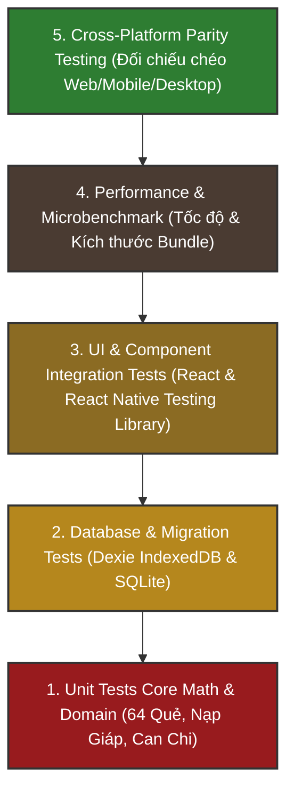

# QUY TRÌNH & CHIẾN LƯỢC KIỂM THỬ (TESTING GUIDE)
## Dự án: Kinh Dịch - Bắc Hà Tân An Phái
**Phiên bản tài liệu:** 1.0.0  
**Ngày cập nhật:** 31/10/2026  
**Tổng số test cases:** 745+ tests (100% Pass)  
**Khung kiểm thử:** Vitest 5.0.5, React Testing Library, JSDOM

---

## 1. TỔNG QUAN CHIẾN LƯỢC KIỂM THỬ (TESTING PYRAMID)

Hệ thống KinhDich áp dụng chiến lược kiểm thử 5 tầng nghiêm ngặt để đảm bảo tính chuẩn xác tuyệt đối của tri thức Kinh Dịch cổ truyền và tính ổn định khi chạy trên đa nền tảng:



---

## 2. BẢNG PHÂN BỔ TEST SUITES THEO WORKSPACE

| Workspace | Số lượng bài test | Phạm vi kiểm tra chính | Kết quả |
| :--- | :--- | :--- | :--- |
| `packages/domain` | **166 tests** (10 files) | Dữ liệu 64 quẻ, Bát Quái Tiên/Hậu thiên, Bát Cung, Nạp Giáp, Settings Types | **100% Pass** |
| `packages/calendar` | **44 tests** (2 files) | Nông lịch Việt Nam, Can Chi 4 trụ, Tiết Khí thiên văn, Tuần Không | **100% Pass** |
| `packages/database` | **76 tests** (6 files) | Dexie IndexedDB CRUD, LocalStorage Settings Repository, Backup & Restore JSON | **100% Pass** |
| `packages/core` | **301 tests** (25 files) | `SERIAL-MOD8-V1`, `MAI-HUA-V1`, Six Yao Orchestrator, Chu Hi, Thể Dụng, Perf Bench | **100% Pass** |
| `apps/mobile` | **32 tests** (2 files) | Giao diện mobile, SQLite repository adapter, migration v1 -> v2, Settings Screen | **100% Pass** |
| `apps/desktop` | **50 tests** (3 files) | Cửa sổ Desktop, SQLite Tauri plugin, menu bar, zoom scaling, Parity Testing | **100% Pass** |
| `apps/web` | **76 tests** (11 files) | PWA offline shell, Form bốc quẻ, Lịch sử, Luận giải, Ghi chú, Settings View | **100% Pass** |
| **Tổng cộng** | **745 tests** | **Toàn bộ hệ thống Monorepo đa nền tảng** | **100% PASS** |

---

## 3. CÁC HẠNG MỤC KIỂM THỬ ĐẶC THÙ

### 3.1. Kiểm thử Tính Bất Biến & Đối Chiếu Chéo Nền Tảng (Parity Testing)
File kiểm thử chuyên biệt [apps/desktop/src/__tests__/multi-platform-parity.spec.ts](file:///E:/bac-ha-tan-an-phai/apps/desktop/src/__tests__/multi-platform-parity.spec.ts) thực thi 6 vector kiểm thử chuẩn mực để đối chiếu kết quả giữa Web (IndexedDB) và SQLite (Desktop/Mobile):
- **Vector A (Seri 6824):** Xác nhận tính toán đồng nhất 100% quẻ Địa Lôi Phục biến Địa Trạch Lâm (hào 1 động).
- **Vector B (Seri 0000 - Edge case toàn số 0):** Xác nhận thuật toán xử lý dư 0 thành quẻ Khôn (#2) và hào 6 động mà không gây lỗi chia cho 0.
- **Vector C (Seri 1234):** Xác nhận phân bổ quẻ Hỏa Lôi Phệ Hạp biến Sơn Lôi Di.
- **Vector D (Mai Hoa Dịch Số):** Đối chiếu Thể Dụng sinh khắc và quẻ biến của một thời khắc cố định.
- **Vector E (Lục Hào Chuyên Sâu):** Kiểm tra Bát Cung, Thế Ứng, Nạp Giáp, Lục Thân, Lục Thú và Tuần Không khớp tuyệt đối trên cả 3 nền tảng.
- **Vector F (Chu Hi Interpretation Rule):** Kiểm tra diễn giải theo 7 quy tắc hào động của Chu Hi.

### 3.2. Kiểm thử Cơ Sở Dữ Liệu & Nâng cấp Migration
- Kiểm tra tính bền vững của các trường dữ liệu khi nâng cấp schema từ phiên bản v1 lên phiên bản v2 (`rule_set_id`, `starred`, `is_verified`).
- Kiểm tra tính tương thích hai chiều của tệp sao lưu JSON giữa Dexie (Web) và SQLite (Mobile/Desktop): Dữ liệu xuất từ Web nhập thành công vào SQLite và ngược lại mà không bị mất mát hay méo mó cấu trúc.

### 3.3. Kiểm thử Ngoại Tuyến (Offline Assurance)
- Giả lập ngắt hoàn toàn kết nối mạng (`navigator.onLine = false`).
- Xác nhận toàn bộ chu trình lập quẻ, nạp giáp, lưu lịch sử, thêm ghi chú và xuất file sao lưu JSON hoạt động bình thường 100%.

---

## 4. CÁC LỆNH KIỂM THỬ THƯỜNG DÙNG

```bash
# 1. Chạy toàn bộ test suites trong Monorepo
pnpm test

# 2. Chạy test cho một package cụ thể (ví dụ core engine)
pnpm --filter @kindich/core test

# 3. Chạy test cho ứng dụng Web
pnpm --filter web test

# 4. Chạy test cho ứng dụng Mobile
pnpm --filter mobile test

# 5. Chạy test cho ứng dụng Desktop
pnpm --filter desktop test

# 6. Kiểm tra kiểu dữ liệu tĩnh toàn bộ dự án
pnpm -r typecheck
```
